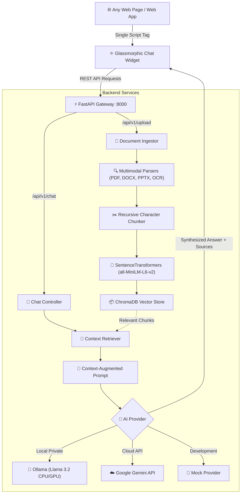

# 🤖 Cross-Platform AI Chatbot

<p align="center">
  
  
  
  
  
  
  
  
  
</p>

<h3 align="center">
  ✨ Build Once, Embed Anywhere — The Ultimate Glassmorphic AI Chatbot & Knowledge Retrieval Engine
</h3>

<p align="center">
  A production-ready, ultra-lightweight AI chatbot ecosystem featuring a <b>single-file embeddable React widget</b> and a high-performance <b>FastAPI backend</b> with multimodal <b>Retrieval-Augmented Generation (RAG)</b>, swappable local/cloud LLMs, and <b>pure-CPU optimization</b>.
</p>

---

## 🌟 Overview

The **Cross-Platform AI Chatbot** is designed to seamlessly integrate into **any website or web application** (HTML5, WordPress, Shopify, Webflow, React, Vue, Next.js, or Angular) using just a **single `<script>` tag**. 

It comes packed with a draggable, frosted-glass UI, multi-theme customization, real-time typing indicators, collapsible Knowledge Base management, and an enterprise-grade document ingestion pipeline that turns your private files into an interactive conversational oracle.

---

## ⚡ Key Highlights

### 🎨 1. Glassmorphism 2.0 Floating Widget
- **Draggable & Responsive**: Freely positionable floating bubble with intuitive drag handles and mobile-first responsive viewport adaptation.
- **Dynamic Theming**: 4 built-in glass presets: **Ocean Blue**, **Galaxy Purple**, **Forest Emerald**, and **Sunset Rose**.
- **Collapsible Knowledge Base**: Visual document management strip displaying indexed files with delete buttons and upload status.
- **Quick Action Prompts**: Suggested chips for instant onboarding, conversation clears, and model status indicators.

### 🧠 2. Hybrid Swappable AI Engine
- 🦙 **Ollama (100% Private Local LLMs)**: Run `llama3.2`, `mistral`, `deepseek-r1`, or `phi3` locally without sending sensitive data to the cloud.
- ☁️ **Google Gemini API**: Connect to `gemini-1.5-flash` or `gemini-1.5-pro` for lightning-fast, high-context cloud intelligence with zero local compute requirements.
- 🧪 **Mock Mode**: Zero-dependency instant response testing without requiring API keys, downloads, or local LLM setup.

### 📚 3. Multimodal Retrieval-Augmented Generation (RAG)
- **Universal File Ingestion**: Ingest PDF (`PyMuPDF`), Word (`python-docx`), PowerPoint (`python-pptx`), Excel (`openpyxl`), Images with OCR (`pytesseract`), Markdown, JSON, Code, RTF, and Plain Text.
- **Semantic Embeddings**: Powered by HuggingFace `sentence-transformers` (`all-MiniLM-L6-v2`) with offline caching to prevent network delays.
- **Vector Search Engine**: Persistent, local `ChromaDB` vector storage with similarity threshold filtering and contextual document chunking.

### 💻 4. CPU-Optimized Hardware Acceleration
- **Pure-CPU Execution**: Specially tuned for laptops and systems without dedicated GPUs (`FORCE_CPU=true`, `OLLAMA_NUM_GPU=0`, multi-threaded evaluation).
- **Fast KV-Cache & Pre-warming**: Reduces context size overhead and pre-warms embedding models during server startup.
- **Greeting Bypass**: Simple greetings ("hi", "hello", "thanks") bypass the vector database for instantaneous sub-second responses.
- **Auto-Failover**: Automatically falls back to CPU mode if a GPU driver or CUDA allocation failure is detected.

### 🚀 5. One-Click Launcher (`start.bat`)
- Automated virtual environment initialization.
- Automatic dependency verification and installation for Python and Node.js.
- Standalone Vite production bundle build (`chat-widget.js`).
- Stale port cleanup (kills leftover processes on ports 8000 & 5173).
- Instant browser launch directly to the interactive demo website.

---

## 🏗️ Architecture



---

## 📁 Repository Structure

```
Cross-Platform-AI-Chatbot/
├── backend/
│   ├── app/
│   │   ├── api/v1/            # Chat & Document Upload REST endpoints
│   │   ├── core/              # Global settings, environment & CPU configs
│   │   ├── db/chroma/         # ChromaDB persistent vector database
│   │   ├── schemas/           # Pydantic request & response schemas
│   │   ├── services/
│   │   │   ├── ai/            # AI Providers (Ollama, Gemini, Mock)
│   │   │   └── rag/           # Parser, Chunker, Retriever, Vector Store
│   │   └── main.py            # FastAPI server & static bundle mounter
│   ├── uploaded_files/        # Document storage directory
│   ├── requirements.txt       # Python backend dependencies
│   ├── .env.example           # Environment template
│   └── .env                   # Local settings (gitignored)
├── widget/
│   ├── src/                   # React chat widget components & styling
│   ├── package.json           # Node.js dependencies & scripts
│   ├── vite.config.js         # Single-bundle IIFE/ESM build configuration
│   └── dist/                  # Prebuilt standalone bundle (chat-widget.js)
├── launcher.py                # Python cross-platform multi-service launcher
├── start.bat                  # 1-Click Windows orchestrator & port release
├── stop.bat                   # Kill all running server instances cleanly
└── test_website.html          # Starry interactive demo website
```

---

## 🚀 Quick Start

### Method 1: One-Click Windows Launch (Recommended)

Simply double-click or run:

```cmd
start.bat
```

The script will automatically configure your environment, build the widget, start the FastAPI backend on `http://localhost:8000`, and open the demo webpage.

To stop the servers at any time:
```cmd
stop.bat
```

---

### Method 2: Manual Setup

#### 1. Backend (FastAPI + RAG)

```bash
cd backend

# Create virtual environment
python -m venv venv

# Activate virtual environment
# On Windows:
venv\Scripts\activate
# On macOS/Linux:
source venv/bin/activate

# Install dependencies
pip install -r requirements.txt

# Create your .env file
cp .env.example .env

# Run FastAPI server
uvicorn app.main:app --reload --port 8000
```

#### 2. Frontend Widget (React + Vite)

```bash
cd widget

# Install Node.js packages
npm install

# Run Vite dev server (for widget development)
npm run dev

# Or compile the standalone bundle for embedding
npm run build
```

The compiled script will be written to `widget/dist/chat-widget.js`.

---

## ⚙️ Configuration (`backend/.env`)

Copy `backend/.env.example` to `backend/.env` and tailor it to your needs:

```ini
# ==========================================
# AI Provider Selection: ollama | gemini | mock
# ==========================================
AI_PROVIDER=ollama

# ==========================================
# Ollama Settings (Local AI)
# ==========================================
OLLAMA_BASE_URL=http://localhost:11434
OLLAMA_MODEL=llama3.2
OLLAMA_NUM_GPU=0         # 0 = Run exclusively on CPU
OLLAMA_NUM_THREAD=8      # Multi-core CPU threading
OLLAMA_NUM_CTX=2048      # Fast context window for quick CPU replies
OLLAMA_KEEP_ALIVE=60m    # Keep model in RAM to prevent reload lag
OLLAMA_TIMEOUT=120.0

# ==========================================
# Hardware / CPU Optimization
# ==========================================
FORCE_CPU=true           # Disables CUDA to avoid GPU crashes
EMBEDDING_DEVICE=cpu     # "cpu" or "cuda"

# ==========================================
# Google Gemini Settings (Cloud AI)
# ==========================================
# GEMINI_API_KEY=your_gemini_api_key_here
# GEMINI_MODEL=gemini-1.5-flash

# ==========================================
# RAG Settings
# ==========================================
RAG_ENABLED=true
CHUNK_SIZE=500
CHUNK_OVERLAP=50
TOP_K_RESULTS=3
```

---

## 🔌 Embedding into Any Website

Embed the chatbot into any HTML page, WordPress site, or web app by placing this snippet before the `</body>` tag:

```html
<!-- Cross-Platform AI Chatbot Widget -->
<script type="module">
  const host = 'http://localhost:8000'; // Replace with your production server URL
  const script = document.createElement('script');
  script.type = 'module';
  script.src = `${host}/chat-widget.js`;
  document.body.appendChild(script);
</script>
```

---

## 📡 REST API Reference

The backend exposes an interactive Swagger API playground at `http://localhost:8000/docs`:

| Method | Endpoint | Description |
|---|---|---|
| `POST` | `/api/v1/chat` | Send a user query, perform RAG retrieval, and return the AI response with cited sources. |
| `POST` | `/api/v1/upload` | Upload and vectorize documents (PDF, DOCX, PPTX, XLSX, Images, TXT). |
| `GET` | `/api/v1/upload` | Retrieve the list of all indexed files and chunk metadata. |
| `DELETE` | `/api/v1/upload/{doc_id}` | Remove a document and its embeddings from the ChromaDB store. |
| `GET` | `/chat-widget.js` | Serves the production standalone compiled React widget. |
| `GET` | `/test` | Serves the interactive starry demo website. |
| `GET` | `/docs` | Interactive Swagger OpenAPI UI. |

---

## 🛠️ Tech Stack

- **Backend**: [FastAPI](https://fastapi.tiangolo.com/), [Pydantic v2](https://docs.pydantic.dev/), [Uvicorn](https://www.uvicorn.org/)
- **Vector Database**: [ChromaDB](https://www.trychroma.com/)
- **Embeddings**: [SentenceTransformers](https://www.sbert.net/) (`all-MiniLM-L6-v2`)
- **Document Processing**: PyMuPDF, python-docx, python-pptx, openpyxl, Tesseract OCR
- **LLM Integrations**: [Ollama](https://ollama.ai/) & [Google Generative AI](https://ai.google.dev/)
- **Frontend Widget**: [React 18](https://react.dev/), [Vite](https://vitejs.dev/), [Lucide Icons](https://lucide.dev/), [Tailwind CSS](https://tailwindcss.com/)

---

## 🤝 Contributing

Contributions, issues, and feature requests are welcome! Feel free to check out the [issues page](https://github.com/tejaspatil-dev26/Cross-Platform-AI-Chatbot/issues).

1. Fork the Project
2. Create your Feature Branch (`git checkout -b feature/AmazingFeature`)
3. Commit your Changes (`git commit -m 'Add some AmazingFeature'`)
4. Push to the Branch (`git push origin feature/AmazingFeature`)
5. Open a Pull Request

---

## 📄 License

Distributed under the **MIT License**. See `LICENSE` for more information.

---

<p align="center">
  Crafted with ❤️ by <a href="https://github.com/tejaspatil-dev26">Tejas Patil</a>
</p>
